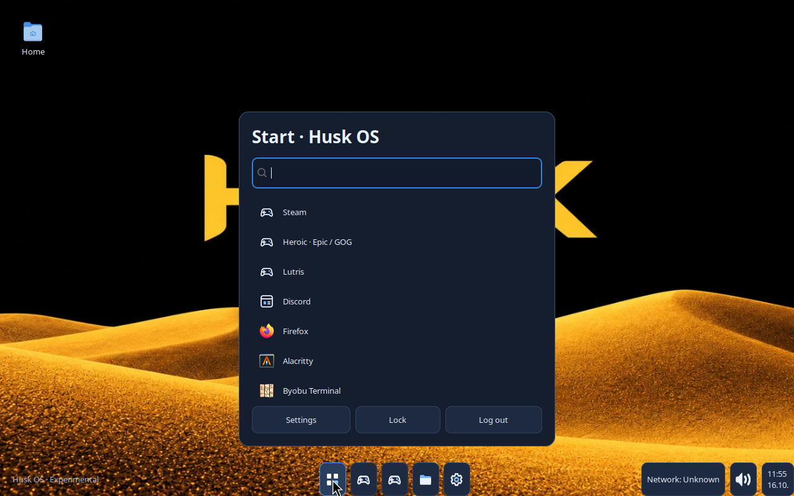
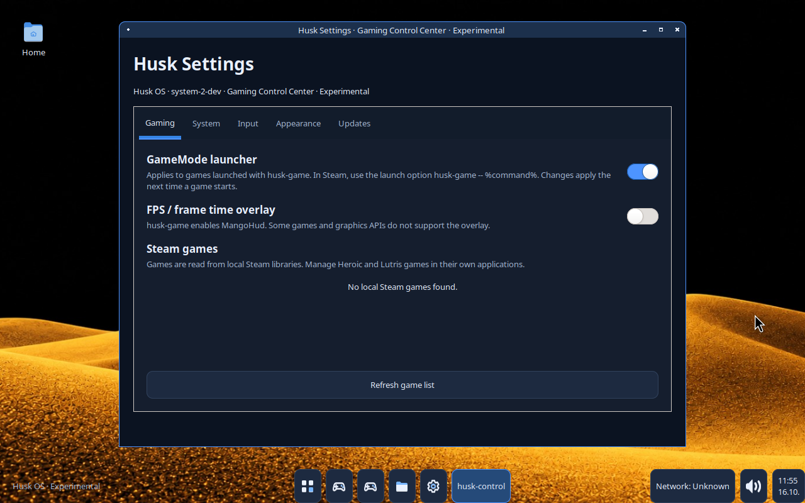

# Husk OS System 2 — development and verification

Date: 2026-10-16. Status: **source milestone verified; no System 2 ISO built**.
Accepted executable source: `993d80bf8a9d94a7f4f43e0a74b65fdafbde62cd`.
Documentation/evidence commits after it do not change executable source.

## Recovery and preservation

The interrupted System 2 work was recovered from the existing
`system2-desktop` worktree on top of GitHub main
`da55fc1e973f1c581efa87e6b235c6deba47dc0b`. English/gettext, Labwc controls,
wallpaper rendering/packaging and regression tests were present but uncommitted.
The project was not restarted. Existing source, compatibility aliases and
System 1 history were retained. Completed milestones were committed, transferred
through the authorized GitHub connection and verified by remote ref and exact
Git tree/blob identities. No force-push or real disk operation was used.

System 1 remains an unchanged historical release, including its ISO/checksum
assets: [System 1](https://github.com/monsteri24/Husk-OS/releases/tag/system-1).
The release ID is `414611526`, ISO asset ID `646339649`, size 2,103,050,240 bytes,
SHA-256 `8f14dc313556db9e56fb37a0ce3ef33f2d46cf35200238fb61a3b6240c856363`.
System 2 will require its own `system-2` release and `HuskOS-system-2.iso`.
No System 2 release or ISO is claimed here.

## Completed source changes

- **English UI:** Husk Desktop/Home, Start search/actions, taskbar menus,
  Settings/Gaming Control Center, Files, notifications and Husk dialogs/helper
  errors use natural English. Husk-owned SDDM and installer text is English.
  `ownos.i18n` provides standard gettext singular/plural entry points, an explicit
  English-only allowlist, fallback and a POT extraction workflow. Finnish host
  variables cannot select a Finnish Husk catalog; no Finnish language selector
  was added. Finnish keyboard layout support remains independent. See
  [LOCALIZATION.md](docs/LOCALIZATION.md) for Qt/toolkit boundaries.
- **Window controls:** the custom Labwc mouse section suppressed implicit
  defaults and omitted Close/Iconify/Maximize actions. Explicit left-click
  actions now restore those controls. Saved System 1 configurations are repaired
  idempotently without replacing existing keybindings, custom/no-op control
  contexts or explicitly enabled default bindings. Buttons were not removed.
- **Official wallpaper:** the exact attachment is included as
  `data/wallpapers/husk-desert.jpg`. The attachment's `.png` name contained JPEG
  bytes; only its extension changed. SHA-256 is
  `e0f2ee190ff6c11a2102251d4fb13f3cad2690a8f3b9ef3bc5e963079aaeeaac`.
  Husk Desktop draws it internally with one uniform centered cover scale,
  clipped to the allocated output, including behind the taskbar. No wallpaper
  daemon/service was added. Settings retains custom image selection/reset;
  invalid images fall back to the official image. Wallpaper survives output
  resize and a temporary absence of monitors no longer passes None to layer-shell.
- **Icons:** five small original MIT SVG assets provide Start, Settings, Files,
  game and generic application icons. Names and desktop-file GIcons are checked
  for loadability; missing/unreadable icons get a visible bundled fallback.
  Real installed application art is retained when available. Source and installed
  hicolor paths, fixed icon sizes, centered alignment and accessible names are
  covered. Required SVG/Cairo dependencies are explicit. Native Labwc decoration
  glyphs remain compositor controls and were exercised by pointer input.
- **UI correctness:** layer-shell popup requests now reserve a usable, bounded
  viewport, avoiding a one-row Start menu. Overlay placement accounts for the
  taskbar correctly. Settings content keeps a readable dark background with
  light text instead of inheriting a white toolkit viewport.
- **Clean base:** neither live edition nor installer desktop choice adds the
  optional gaming/app bundle. The profile filters known optional upstream apps,
  retains reviewed boot/recovery utilities and stops on unreviewed additions.
  Existing installed-image app bundles are included in installer cleanup policy.
  Kernel, firmware, Labwc/Husk, essential utilities, audio/network components and
  graphics libraries remain; standard builds retain 32-bit graphics libraries.
- **Build checks:** UI packaging includes the original wallpaper/icons; installed
  rootfs validation requires new modules/assets and reads authoritative pacman
  `%NAME%` records, including dependencies, to reject known optional apps.

The modular panel, launcher, configuration, themes, file manager, notifications,
native toplevel bridge and gaming command wrappers are retained. Arch Linux,
Labwc and the existing Archiso boot mechanism remain the technical base.

## Optional application installation and unfinished architecture

Steam/Proton, Wine, Lutris, Discord, Firefox, OBS and optional launchers are
excluded from default package policy. A launcher catalog entry does not mean an
app is installed: absent apps require a user-confirmed installation action.
The existing curated helper uses signed Arch package transactions/full upgrades
or official user-level Flathub installation. A Flathub remote with an unexpected
URL or disabled GPG verification is refused before changes. Let Steam manage
Proton after user-requested Steam installation. The base desktop/local utilities
do not depend on optional application downloads at startup.

These command contracts and package policies are tested; real downloads,
signature transactions, application launches and games were not retested.
No FPS or game compatibility result is claimed. See
[APP-INSTALLATION.md](docs/APP-INSTALLATION.md).

**Planned, not completed:** Husk Store, the native `.hpk` package ecosystem and
a maintained signed Husk repository/key lifecycle. `.hpk` remains the selected
native extension; no functioning parser/signing/store/installer is invented.
Calamares and the Husk/KDE/GNOME/Minimal choices remain experimental source;
no actual target installation was performed.

## Final test evidence

Both final Actions runs used accepted source `993d80bf8a9d94a7f4f43e0a74b65fdafbde62cd`:

- [Source, native and GTK CI](https://github.com/monsteri24/Husk-OS/actions/runs/38896881466)
  — **PASSED**, job `116959361337`.
- [Real Labwc/Wayland integration](https://github.com/monsteri24/Husk-OS/actions/runs/38896881547)
  — **PASSED**, job `116959361215`.

| Check | Passed | Failed | Skipped | Scope |
|---|---:|---:|---:|---|
| Headless unittest pass | 148 | 0 | 16 | 164 discovered tests; display tests skipped |
| Full GTK/Xvfb unittest pass | 164 | 0 | 0 | English labels/plurals, icons, wallpaper fallback, CSS, settings, regressions |
| Source/configuration syntax checks | 113 | 0 | 0 | Separate from unittest counts |
| Native build and ASan/UBSan JSON helper | passed | 0 | 0 | Normal CI environment; no memory-leak claim for desktop |
| Real Labwc integration scenarios | 10 | 0 | 0 | Separate compositor acceptance checks, not ten hardware tests |
| New Arch binary package/ISO build | — | — | — | **NOT TESTED** in this source phase |
| System 2 QEMU/OVMF boot | — | — | — | **NOT TESTED**; there is no new ISO |
| System 2 physical hardware | — | — | — | **NOT TESTED** |

The compositor test stages actual package functions in a disposable Ubuntu 24.04
runner. Xvfb is only the isolated parent X server; Husk Desktop and applications
are real Wayland clients of Labwc (`GdkWaylandDisplay`, layer-shell and native
foreign-toplevel bridge). XTest pointer/keyboard events perform the actions;
the observer only records geometry/state. This is distinct from `--preview`
and from an Arch ISO/DRM/KMS boot. Versions: Labwc 0.7.1, wlroots 0.17.1,
GtkLayerShell 0.8.2, Foot 1.16.2, PyGObject 3.48.2.

The ten scenarios establish desktop startup, original wallpaper pixels,
Start click/search/Foot launch, reproduction of the old broken X, closure of
the same window after the real saved-config migration, and X/minimize/maximize/
restore/taskbar activation for Foot, Husk Files and Husk Settings. The desktop
and D-Bus/native bridge remain alive. Wallpaper pixel comparisons passed at
1280×800 and after an actual output resize to 1280×960. Other resolutions have
placement mathematics tests, not physical display acceptance.

Permanent selected evidence: [summary](docs/evidence/system2/labwc-result.json),
[input events](docs/evidence/system2/input-events.jsonl),
[versions](docs/evidence/system2/versions.txt),
[old config](docs/evidence/system2/legacy-rc.xml),
[migrated config](docs/evidence/system2/migrated-rc.xml).

These are unaltered grim screenshots from the final real compositor run,
not generated artwork or mockups. The CI host has unrelated applications in
its global desktop-entry directory; entries visible in this source-test Start
menu are not an inventory of a Husk ISO.

The full Actions artifact `12044078330` contains original screenshots/logs,
is 11,145,530 bytes, and expires on 2026-11-15. It was downloaded and checked:
SHA-256 `6a3a43c11e5f4db3cda03bd825503fbe9ec8c067ae5fb6a6fbb28df2af5f83ba`.
Selected evidence is committed here so that acceptance evidence survives that
artifact expiry. Screenshot SHA-256 values:

- Start: `3961fd04649f00d5959ca0efadcbf96a6545eb9605e8601fdcb3b372d502ae96`
- Settings: `1905059a0e91ed5872b254bebecc81363d231faa8a6cf70d487ed38da760de98`

## Failures found and corrected

- Initial GTK runs failed to decode bundled SVGs. Added the explicit SVG loader
  in both CI environments and `librsvg` in UI dependencies. Later complete GTK
  runs passed; the failures were not hidden as skips.
- Early nested-compositor tests failed before desktop launch because bare Xvfb
  output windows had no title/class hints. Geometry-based X tree discovery now
  has a regression test. Failed discovery evidence is preserved.
- Actual wallpaper comparison detected a surface shortened by the taskbar's
  exclusive zone. Background surfaces now span the full output; pixel evidence
  verifies the correction.
- Start launch testing exposed undersized layer-shell popups and stale/offscreen
  test coordinates. Corrected production allocation/placement and required
  actual typed search text plus the filtered row before clicking.
- A subsequent test selected the Files launcher instead of its identically
  named task button. The observer now exposes task buttons separately; no
  production behavior was changed to make that test pass.
- Final screenshot inspection found low-contrast Settings content. The dark
  viewport fix now has a real GTK contrast regression test and fresh CI evidence.

Representative failed summaries are retained under `docs/evidence/system2/`.
The first complete compositor success was run `38896401417`; after the contrast
fix, final run `38896881547` repeated all ten scenarios successfully.

Local `make check` was blocked at LeakSanitizer's restricted `/proc/task`
inspection. No safety check was disabled; the unmodified native sanitizer check
passed in CI. Local Python/syntax runs completed with display skips, while the
prepared CI environment ran those display tests successfully.

## Verified GitHub source milestones

| Remote commit | Milestone |
|---|---|
| `7e64d9d50768d219cd284feaa47f35684039a139` | Recover English UI, window controls and exact wallpaper |
| `48fd2d547143bbf77db19ad7ca31537b7ea26ff0` | Icons, gettext template and real-compositor test workflow |
| `007691f3d41a4af8e04723e041e77d7e44c2cb88` | Clean defaults and trusted optional installation checks |
| `770bbae569e52b72a51bdb269e1bfb626f091401` | Explicit SVG decoding dependency |
| `e6dc99b1d4a0c9f47e07e93fb34b7ed2373da96b` | Output discovery without WM hints |
| `24af4da6c40c6195329f40926343e50da8e1ced2` | Installed rootfs inventory/assets acceptance |
| `826e82f03f9898d92e76d502d5270f9f3ea7df79` | Full-output wallpaper surface |
| `d0d4108d9299ad8a6be3c6aebd64c4178efe41d8` | Usable popups and genuine launcher keyboard verification |
| `d5d093ec469358f02f5e51552eb93586ec4fa3ad` | Correct taskbar restoration test targeting |
| `993d80bf8a9d94a7f4f43e0a74b65fdafbde62cd` | Readable Settings contrast; final accepted source |

Every listed remote ref update was verified after transfer. Original history
remains in the ancestry. This report and selected evidence are saved in a later
documentation-only commit; executable source is unchanged from the accepted SHA.

## Remaining acceptance work and ISO readiness

The source is ready for a **System 2 candidate Archiso build**, not a finished
bootable System 2 release. Build on Arch using the existing signed package/profile
mechanism, run the new installed-rootfs checks and then test the resulting image
through QEMU/OVMF. Prepare a separate System 2 release workflow; the System 1
workflow intentionally refuses to overwrite its historical asset.

Still untested for System 2: the actual Arch package dependency transaction,
ISO/UEFI/kernel/initramfs/autologin chain, installed system, shutdown/reboot,
SDDM login, real lock/unlock/logout, custom wallpaper picker interaction,
physical multi-monitor/HiDPI, NVIDIA/hybrid graphics, network/audio/Bluetooth,
gamepads, suspend/battery and games. No performance, FPS, power or memory-leak
result is invented. The original ASUS ROG System 1 boot is user-reported evidence;
it is not a System 2 hardware test or a certification of all ASUS models.

Nonfatal logs in this headless integration environment include an absent AT-SPI
service and an unsupported compositor text-input/IME interface. Accessibility
and IME behavior require follow-up; they were not silently certified. A terminal
Hangup warning accompanies its requested closure. Dragging/snapping, broader
application window types and long-running stability also need acceptance tests.

Next priorities: build and verify the new Arch ISO, boot-test its full chain,
repeat the fixes on the physical ASUS ROG with exact hardware recorded, validate
offline/system service behavior, then complete a safe installer and maintained
signed update repository. Preserve System 1 throughout.
