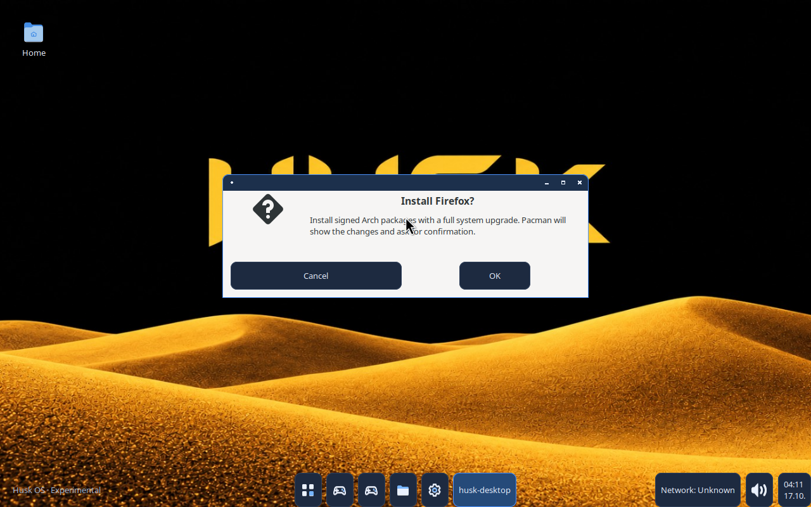
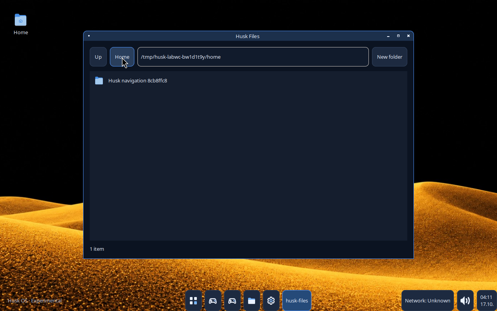

# Husk OS System 2 — recovery, verification and release report

Updated: 2026-10-17. **Current status: source/GTK and real desktop accepted; genuine System 2 ISO built and filesystem-checked; boot/publication pending.** This report separates verified results from planned gates.

## Recovery and preserved work

The 2026-10-17 continuation checked GitHub `main`, recent commits, completed Actions runs and all published release assets before editing source. Recovered main was `c3a78a2c8d414b2e03c60816ab87532fe10ae681`. Accepted image source is now `b1c27dd8bc73d7dc4e9f9856083dd69c67f30d58`. The previous session's two unpushed test corrections survived locally and are being completed without restarting the project.

The initial V3 recovery inspected all tracked paths, 26 historical commits and their changes, source/tests/build scripts, previous plans/reports, 38 Actions results and release metadata. Recovered main was `6b254a27898386b40bf070d2af10c881194c346f`; the latest earlier executable source with both complete GTK and real Labwc acceptance was `993d80bf8a9d94a7f4f43e0a74b65fdafbde62cd`. See [recovery inventory](docs/SYSTEM2-RECOVERY-V3.md). The [earlier source milestone report](https://github.com/monsteri24/Husk-OS/blob/c3a78a2c8d414b2e03c60816ab87532fe10ae681/HuskOS-system-2-REPORT.md) remains in Git history; its English-only/Finnish and test-count statements describe that earlier milestone, not this candidate.

Preserved commits include `03a5948` (recovery inventory), `2778f2e` (existing gettext Finnish draft and application reliability work) and `c3a78a2` (fresh dialog input, bounded desktop input and build ownership corrections). No history rewrite, source rollback, replacement desktop or deletion of old assets was performed.

[System 1](https://github.com/monsteri24/Husk-OS/releases/tag/system-1) remains unchanged: release ID `414611526`, ISO asset ID `646339649`, `HuskOS-system-1.iso`, **2,103,050,240 bytes**, SHA-256 `8f14dc313556db9e56fb37a0ce3ef33f2d46cf35200238fb61a3b6240c856363`. The historical ASUS ROG USB boot applies to System 1 only.

## Current implementation inventory

| Requirement | Status | Evidence or limit |
|---|---|---|
| Original GTK Husk Desktop, Labwc/Wayland, Start/search/taskbar | COMPLETE for previously accepted scenarios | Existing architecture and real compositor checks preserved; prolonged stability still needs testing |
| Close/minimize/maximize/restore and same-window taskbar focus | COMPLETE for tested Foot, Files and Settings | Actual Labwc decoration clicks passed again at `c3a78a2` |
| Official wallpaper | COMPLETE for prior tested package/resolution cases | Exact bytes and real output pixels verified; actual System 2 ISO still pending |
| English UI | COMPLETE for tested Husk views | English-only fallback and six actual GTK language-policy cases passed |
| Finnish localization | POSTPONED by release decision | Draft PO retained for future work; no selectable Finnish release option |
| Husk Settings | PARTIAL | Real appearance/input/wrapper settings, GPU information and display-tool launch; VRR, CPU policy, Optimus and hardware behavior unaccepted/planned |
| Husk Files navigation and controls | COMPLETE for tested cases | Real folder/Home/Up/location navigation and window controls passed at `c3a78a2` |
| Terminal | COMPLETE for tested cases | Actual Super+Return launch, typed shell command/file round trip and controls passed at `c3a78a2` |
| Installation confirmation/cancellation | COMPLETE for tested cases | GTK and real Labwc confirmed default/fresh Cancel, inherited pointer-release rejection, cross-button drag and deliberate pointer/keyboard OK |
| Native/Flatpak install outcome and launch | PARTIAL | Authoritative package-state checks, visible held terminal, cancellation/error handling and trusted sources tested; actual signed transaction/launch gate pending |
| Gaming libraries and optional launchers | IMPLEMENTED BUT UNVERIFIED on hardware | 64-bit Mesa first-boot base; apps/32-bit tools on demand; no game/FPS/anti-cheat guarantees |
| Native `.hpk` ecosystem | MISSING, intentionally planned | Existing design retained; no speculative implementation |
| Permanent graphical OS installer | PARTIAL experimental source | Omitted from default Live build; no accepted target installation |
| System 2 ISO/release | PARTIAL | Genuine ISO built; ISO9660/UEFI structure and extracted payload passed. Boot and publication pending |

The official desktop image remains `data/wallpapers/husk-desert.jpg`, 1536×864, SHA-256 `e0f2ee190ff6c11a2102251d4fb13f3cad2690a8f3b9ef3bc5e963079aaeeaac`. The exact authoritative hash is checked by packaging/rootfs tests. The supplied rounded-corner branding variant does not replace the documented original wallpaper.

## Fixes and acceptance failures

- Native/Flatpak installation success now requires the authoritative installed package/app record. A zero process result or an unrelated executable in PATH is insufficient. Foot `--hold` keeps progress and outcomes visible. The next Start activation launches a verified installed application.
- Fresh Live native installation deliberately prepares the `live` user's temporary password through interactive `passwd`; normal polkit administrator authentication and package-manager confirmation remain mandatory. No passwordless grant is supplied. Settings' older direct administrative actions require setting that password manually first.
- The confirmation's OK button requires a new matching pointer/key press and release. Held opening keys are consumed until released; Cancel remains the focused default.
- The first graphical candidate stalled at `xdotool mousemove --sync` when the pointer already occupied the folder-row target. Removing that motion-event wait retained ordered input and actual application-state waits. The next real run passed full Files navigation.
- The next desktop test incorrectly required the Ubuntu host Firefox executable to be absent. The corrected precondition uses production `app_installed(app_by_id('firefox'))`; the host browser is neither hidden nor removed.
- Two GTK Cancel tests used synthetic key events with no hardware keycode/group. The changed helper resolves and validates a real keymap entry before normal GtkWindow dispatch. Production Cancel is unchanged by this test correction. The earlier animation-timing explanation did not resolve the failure and is not treated as established.
- ISO build output ownership is restored to the host runner before QEMU/release steps; Firefox's separate headless screenshot uses a builder-owned directory.

Failed candidate summaries are preserved in [V3 evidence](docs/evidence/system2-v3/). No failed candidate is described as accepted, and no identical failing run is repeatedly retried.

## Tests and actual runtime evidence

| Run / scope | Passed | Failed | Skipped | Interpretation |
|---|---:|---:|---:|---|
| Earlier accepted complete GTK at `993d80b` | 164 | 0 | 0 | Historical source baseline |
| Earlier accepted real Labwc at `993d80b` | 10 scenarios | 0 | 0 | Historical compositor acceptance |
| `c3a78a2` headless suite | 203 | 0 | 37 | 240 discovered, not a display acceptance result |
| `c3a78a2` full GTK | 238 | 2 | 0 | Default Cancel tests failed; keymap correction pending |
| `c3a78a2` real Labwc | 10 scenarios completed | 1 precondition failure | — | Navigation and controls passed; installation scenarios not reached |
| Current English-only headless candidate | 198 | 0 | 36 | 234 discovered; 119 separate source/configuration checks passed |
| Accepted `b1c27dd` full GTK | 234 | 0 | 0 | Includes both corrected Cancel tests and six English-only policy cases |
| Accepted `b1c27dd` real Labwc | 18 scenarios | 0 | 0 | All controls/navigation/confirmation/wallpaper cases passed |
| System 2 Arch packages / actual ISO filesystem | PASSED | 0 | 0 | Signed packages and actual extracted ISO checked |
| System 2 QEMU/OVMF boot / terminal / shutdown | pending | — | — | No System 2 boot claim |
| System 2 physical hardware | NOT TESTED | — | — | User hardware testing remains separate |

Historical failed source job: [38936617990](https://github.com/monsteri24/Husk-OS/actions/runs/38936617990). Latest failed real desktop job: [38936618020](https://github.com/monsteri24/Husk-OS/actions/runs/38936618020). Source syntax and native sanitizer checks passed there before the two GTK failures.

Nested desktop acceptance uses actual Labwc Wayland surfaces/clients, the native foreign-toplevel bridge and ordered XTest input under an isolated Xvfb parent. Its observer only records state/geometry. It is distinct from a GTK preview, Arch ISO boot or physical DRM/KMS hardware acceptance.

## ISO and GitHub publication

Filename: **`HuskOS-system-2.iso`**. Actual size: **2,101,264,384 bytes**. SHA-256: **`d36214faecce244cf5c92e0730849857821499cae4f20c3bd71f2448952e8f99`**. Build and actual-rootfs checks: **PASSED**. Boot: **NOT TESTED**. Release: **NOT PUBLISHED**. No accepted public ISO download is claimed at this checkpoint.

Build run [39001566844](https://github.com/monsteri24/Husk-OS/actions/runs/39001566844) passed source/native/GTK and all 18 real Labwc scenarios. The genuine ISO and its checksum are preserved as recovery artifact `12089646677` (ZIP size 2,084,388,443 bytes, ZIP SHA-256 `474e54f5a9b84b83e4969605019817cc2c8bd1cefefa19a083a57348fcb099f5`, expires 2026-10-24). This ZIP digest differs from the ISO digest above.

The later CI-only Firefox test failed: its single `y` was consumed by a JACK-provider choice, followed by a font-provider choice and EOF at the actual installation confirmation. Production interactive prompts were not bypassed. The CI setup now selects explicit trusted `pipewire-jack` and `noto-fonts` providers before the real helper transaction. A continuation workflow reuses the exact checksum-pinned ISO, rechecks its extracted filesystem and embedded signed helper, and completes the application/boot/publication gates; it does not rebuild the image.

Continuation `a59c2d9` passed all 234 GTK tests and 121 syntax checks, but its
desktop repeat stopped after 15 scenarios before a second Firefox confirmation.
Recorded state showed the correct curated row clicked about 4 ms after the last
key release, while SearchEntry could still replace that row. The harness now
reuses an unchanged query and requires fresh, stable row identity/allocation;
the observer's passive pointer log also uses the proper numeric button accessor.
No desktop timeout was increased and no OS payload source changed. The
[failed continuation and diagnosis](docs/evidence/system2-v3/verification-a59c2d9.json)
remain recorded; the new real run is pending.

The existing separate [System 2 workflow](.github/workflows/system2-iso.yml) reuses source/GTK/native and real desktop gates, signed Arch packaging, Archiso and the proven first-boot TTY1/PAM path. It validates ISO9660/UEFI/kernel/initramfs/SquashFS, extracts the completed ISO to inspect the actual payload and wallpaper/package inventory, then boots the exact checksummed image with QEMU/OVMF and verifies Foot plus shutdown. It also performs a real signed Firefox transaction and headless launch in a separate disposable Arch build container. That transaction does not alter the ISO and does not prove Live GUI/polkit authentication.

Publication requires those gates and verifies the uploaded asset's size, digest and a complete fresh download. System 1 is preserved. ISOs and private signing keys are never committed to normal Git history.

## Remaining work and user guidance

Critical release gates: complete the corrected independent signed Firefox transaction/launch, exact-image UEFI boot and verified publication. Current source/GTK, real Labwc confirmation, signed package/ISO creation and actual-rootfs validation have passed. A Live GUI/polkit-authenticated network installation remains an explicitly unaccepted end-to-end path even if the independent transaction and dialog checks pass.

Hardware work remains: physical USB boot, NVIDIA/AMD/Intel and Optimus, Wi-Fi/audio/controllers, refresh/VRR/multi-monitor, suspend and extended session stability. Gaming launchers, Proton/Wine, individual games and anti-cheat compatibility need separate tests. No universal Windows-game or performance claim is made.

Use [INSTALL.md](docs/INSTALL.md) for real release/checksum/USB/Live instructions and actual installer limitations; [APP-INSTALLATION.md](docs/APP-INSTALLATION.md) describes confirmations, authentication, progress and package sources. These guides distinguish verified source behavior from unaccepted Live transactions.

## Current permanent source/desktop evidence

[Full GTK summary](docs/evidence/system2-v3/source-b1c27dd.json), [18-scenario result](docs/evidence/system2-v3/labwc-b1c27dd-summary.json), [input events](docs/evidence/system2-v3/labwc-b1c27dd-input-events.jsonl), [artifact and screenshot identities](docs/evidence/system2-v3/labwc-b1c27dd-metadata.json). These are real captured outputs. The source-test installer terminal reports the Ubuntu host’s missing pkexec and does not establish a successful package installation.

